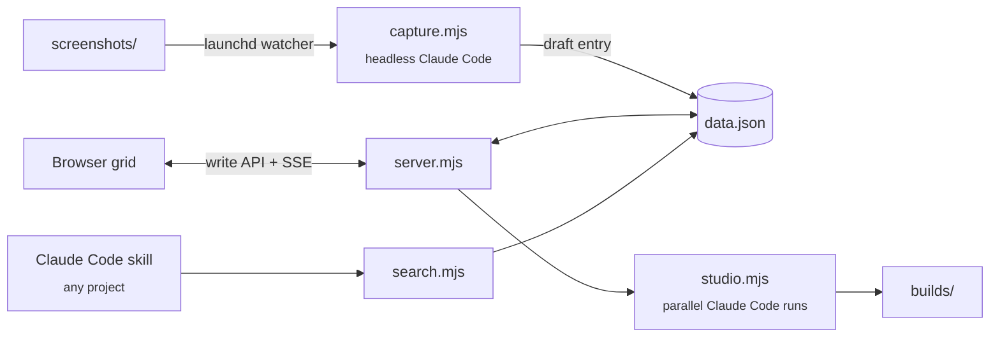

<div align="center">

# Website Inspo Library

**A local, searchable library of website designs that Claude Code reads before it builds anything.**

[](LICENSE)


</div>

I keep screenshots of website designs I like. Folders of pictures are hard to search and useless to a coding agent, so this library stores each design with the analysis already done: a screenshot, the source URL, at least six tags, an **image recipe** (how the visual is built), a **copy brief** (how the words work) and a ready-to-run **image prompt**. The browser grid, a command line search and a Claude Code skill all read the same `data.json`, so when I ask Claude for a hero section it searches my references first.

The **Studio** tab goes one step further: it turns a one-sentence brief into four complete landing pages built from those references, and lets me pick instead of describing what is wrong.

Vanilla HTML, CSS and JavaScript with a Node standard library server. No framework, no build step, no npm packages.

## Features

- **Filterable grid** of designs, sorted into curated groups that each have their own colour. Click a tag to filter by it; press `/` to focus the filter and `Esc` to close a sheet.
- **Add and edit in the browser.** The local server owns every write, so edits land in `data.json`, not in browser storage.
- **Live updates.** The server watches `data.json` and pushes changes over Server-Sent Events, with a 10-second poll as backup. Your filter, scroll position and half-typed form fields are kept.
- **Automatic capture** (macOS). Drop a screenshot into `screenshots/` and a headless Claude Code run writes the tags, recipe, copy brief and image prompt, and proposes a group. The result stays a **draft** until you add the URL and press **Approve entry**. Drafts are hidden from search.
- **Motion capture.** `motion.mjs` visits an entry's live site headlessly and records its transitions, keyframes, hover states and scroll behaviour.
- **Studio.** Brief, then references, then four landing pages generated in parallel, each from a different structural idea. Pick one, then pick from four restylings of it.
- **Workspace and inspector.** Open a generated page in its own tab to zoom, comment, present, edit styles by hand, or describe a change in words (Tweak) and watch it applied. Every edit is written back to the page's file.
- **Claude Code skill** that searches the library from any project.

## Getting started

### Prerequisites

- [Node.js](https://nodejs.org/) 24 or newer
- [Claude Code](https://claude.com/claude-code) on your PATH (`claude`), for capture, Studio and Tweak. Browsing, editing and search work without it.
- macOS, for the automatic capture watcher (it uses `launchd`). The rest runs wherever Node runs.

### Run

```bash
git clone https://github.com/AlexMakesC0de/website-inspo-library.git
cd website-inspo-library
node server.mjs          # http://localhost:4610
```

A fresh clone starts empty: `data.json`, `screenshots/` and `builds/` are personal and not in the repository, and the server creates an empty `data.json` on first run. Use another port with `PORT=5000 node server.mjs`. Opening `index.html` straight from disk also works, but the library is then read-only.

## Usage

### Add a design

**By hand:** press **Add entry** in the grid and fill in the fields.

**Automatically (macOS):** install the watcher once, then drop screenshots into `screenshots/`.

```bash
node watcher/install.mjs            # install and start
node watcher/install.mjs --status   # is it loaded?
node watcher/install.mjs --remove   # uninstall
node capture.mjs                    # run a capture by hand
node capture.mjs --dry-run          # list what would be processed
```

### Capture motion

Needs the `browse` tool from the gstack Claude Code skill.

```bash
node motion.mjs                     # every entry without motion data
node motion.mjs <entry-id>          # one entry
node motion.mjs --refresh           # re-capture everything
node motion.mjs --list              # show what is captured
```

### Search from the terminal

```bash
node search.mjs "minimal editorial hero"
node search.mjs --group <group-id>
node search.mjs "halftone" --limit 3 --json
node search.mjs --list
```

Search covers titles, descriptors, tags, groups, recipes, copy briefs, prompts and notes, and a tag match ranks above a match in prose.

### Generate with the Studio

Use the **Studio** tab, or run it headless:

```bash
node studio.mjs "a landing page for a small-batch coffee roaster"
node studio.mjs "..." --refs <id>,<id> --variants 4
node studio.mjs --list
```

Each project is written to `builds/<project>/` as self-contained HTML. References are used for character and principles, never layout: the generator does not see the screenshots or URLs, and every page names in its header which references influenced it and one thing it refused to take. A restyle that keeps less than 60% of the chosen page's copy is reported as failed.

### Connect it to Claude Code

```bash
node install-skill.mjs              # install or repair
node install-skill.mjs --remove     # uninstall
```

This symlinks `skill/design-library` into `~/.claude/skills/`, so the skill works in every project. Start a new Claude Code session afterwards.

## How it works



`server.mjs` serves the pages, owns all writes (it writes to a temporary file and renames it, so a crash cannot leave half a file), streams changes to open tabs and exposes the Studio API. `studio.mjs` searches the library for references, starts the Claude Code runs and validates what they produce.

## Configuration

All optional.

| Variable | Default | Used by |
| --- | --- | --- |
| `PORT` | `4610` | `server.mjs` |
| `CLAUDE_BIN` | `claude` | capture, motion, Studio |
| `CAPTURE_MODEL` | `sonnet` | `capture.mjs` |
| `MOTION_MODEL` | `sonnet` | `motion.mjs` |
| `STUDIO_MODEL` / `STUDIO_EFFORT` | `sonnet` / `high` | Studio generation |
| `STUDIO_TIMEOUT` | `900000` (ms) | Studio generation |
| `TWEAK_MODEL` / `TWEAK_EFFORT` | `sonnet` / `medium` | Tweak |

## Project structure

```text
index.html             Grid, detail sheet, editor and Studio
view.html              Workspace for one generated page
assets/                Styles, app logic, Studio, inspector and Tweak
server.mjs             Static server, write API and Studio API
studio.mjs             Studio generator and CLI
capture.mjs            Screenshot to draft entry
motion.mjs             Live-site motion capture
search.mjs             Command line search
install-skill.mjs      Installs the Claude Code skill
watcher/install.mjs    Installs the macOS capture watcher
skill/design-library/  The Claude Code skill
PRODUCT.md             What the library is for
DESIGN.md              The visual design system
STUDIO.md              The Studio's plan and decisions
```

## License

[MIT](LICENSE)
